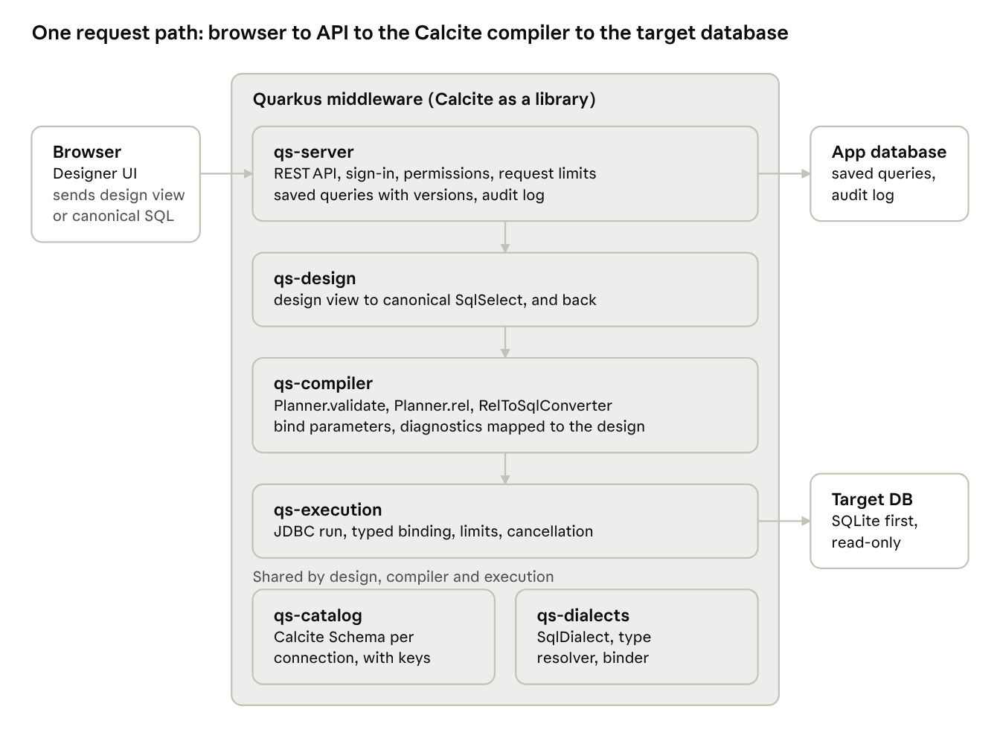
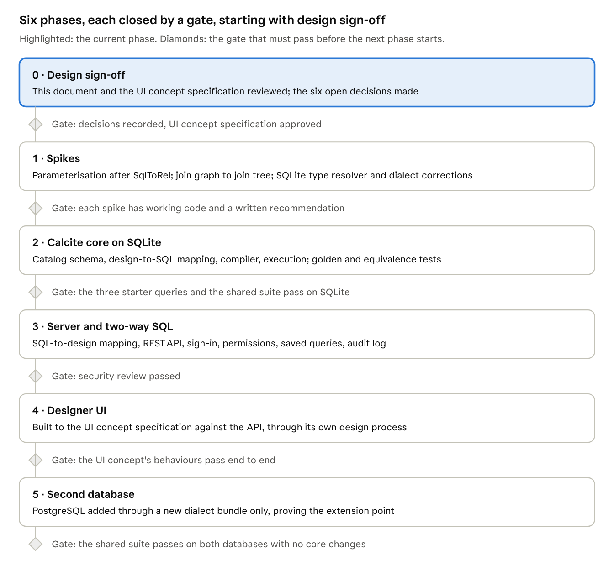

# Query Studio — Technical Design

2026-11-28 · Exported from the [claude.ai document](https://claude.ai/artifact/79H6vGBVuQNCb1gPdFS71T). Companion documents: [Access query designer reference](access-reference.md) · [UI concept specification](ui-concept-specification.md)

## Summary

Query Studio is an Access-style visual query designer backed by Java middleware in which Apache Calcite is the semantic core: Calcite's schema, type system, parser, validator and relational algebra represent every query, and the target database's SQL is generated from them. The browser edits a design; the server owns the catalog, the canonical query, validation, SQL generation and execution.

**A designer, not a query tool (2026-11-28).** Query Studio is one component of a larger system. Its output is a valid SQL string for the target database; how that string reaches the systems that run queries is outside this design. Running a query here only validates and previews the design, so execution stays small: a bounded, read-only preview.

**Delivery is strict test-driven development.** No production code is written except to make a failing test pass. The delivery plan sets out the rules.

**Goals**

- Connect to a database, read its catalog, and load tables, columns, keys and foreign keys into the designer.
- Let users build SELECT queries with the canvas-and-grid interaction defined by the prototype, with a SQL view that stays in step with the design in both directions.
- Generate correct, parameterised SQL for each supported database from one canonical representation. SQLite first.
- Be safe to point at production databases: read-only, validated, bounded and audited.

**Non-goals for the first release**

- Data modification (INSERT, UPDATE, DELETE, make-table, append) and DDL.
- Calcite executing queries itself (no federation, no enumerable execution). Calcite generates SQL; the target database runs it.
- A visual designer for every possible SQL query. Queries the designer cannot represent open in SQL view only, as Access does.

**Inputs to this design**

- The prototype `query-studio.html` defines the UI concept and layout only. Its code, data structures, criteria grammar and join rules are not requirements. A separate [UI concept specification](ui-concept-specification.md) captures what users see and do.
- A first implementation attempt was discarded. It built its own catalog model, type enums, criteria parser and validator, and used Calcite only to print SQL. This design replaces that approach; the lessons it produced are recorded in the dialect section.

## Requirements

The functional scope follows the prototype's UI concept; the non-functional requirements are what make it fit for enterprise use.

| ID | Requirement | Notes |
| --- | --- | --- |
| F1 | Choose a connection from those an administrator configured | Users never enter JDBC URLs or file paths |
| F2 | Load the catalog: schemas, tables, views, columns with full types, primary keys, foreign keys | Large schemas load lazily and are searchable |
| F3 | Add tables and saved queries to a canvas; foreign keys and Access's AutoJoin rule draw join lines automatically | A second copy of a table is named Table\_1, as in Access |
| F4 | Create, edit and remove join lines; choose one of Access's three Join Properties options | Join meaning must not depend on canvas position |
| F5 | Design grid as in Access: Field, Table, Total, Sort, Show, Criteria and any number of or rows; Unique Values, Unique Records and Top Values; parameter prompts | Cells hold standard SQL, parsed by Calcite; a criteria cell may leave out its column |
| F6 | SQL view that updates as the design changes, and a design view rebuilt from edited SQL where representable | Unrepresentable SQL stays in SQL view only |
| F7 | Run a query and see a typed result preview, to check the design | Preview only; result exports are dropped (2026-11-28): other systems run the SQL |
| F8 | Save, open, rename and share queries | Stored on the server, not in the browser |
| N1 | Security: authenticated users, per-connection permissions, read-only access, no client text executed verbatim | See the security model |
| N2 | Multiple databases from one canonical query, added without changing the core | Calcite `SqlDialect` per target |
| N3 | Bounded cost: statement timeouts, row limits, cancellation, request size limits | Defaults set by an administrator |
| N4 | Auditability: who ran what SQL against which connection, when, how many rows | Structured log, retained per policy |
| N5 | Responsiveness: design-to-SQL feedback under 200 ms for typical queries | Catalog cached per connection |

## Architecture overview

Every query exists in exactly one canonical form, a Calcite `SqlNode` tree, and every other form is derived from it: the design view the browser shows, the target SQL the database runs, and the text that is saved. The middleware is a Quarkus service; Calcite is a library inside it, never a separate engine.



The browser talks only to `qs-server`; only `qs-execution` talks to the target database, and only through SQL that `qs-compiler` generated.

**Request flow for a design change**

1. The browser sends the edited design view and layout.
2. The design mapper builds the canonical `SqlSelect` from it.
3. The compiler parameterises literals, validates against the connection's Calcite schema, converts to relational algebra and writes target SQL with the connection's `SqlDialect`.
4. The server returns the canonical SQL, the target SQL, the result row type and any diagnostics mapped back to design elements.

**Request flow for an edited SQL view** runs the other way: the server parses and validates the SQL, then the design mapper rebuilds a design view if the query is representable.

**Modules (Maven)**

| Module | Responsibility | Main Calcite types |
| --- | --- | --- |
| `qs-catalog` | Builds and caches a Calcite schema per connection; loads keys and foreign keys | `JdbcSchema`, `Statistic`, `RelReferentialConstraint`, `RelDataType` |
| `qs-design` | Maps the design view to the canonical `SqlSelect` and back | `SqlSelect`, `SqlJoin`, `SqlIdentifier`, `SqlCall` |
| `qs-compiler` | Parameterisation, validation, `SqlToRel`, `RelToSql`, diagnostics | `Planner`, `SqlValidator`, `RelRoot`, `RelToSqlConverter`, `SqlDialect` |
| `qs-dialects` | Per-database extensions: dialect, type and binding rules, catalog quirks | `SqlDialect` subclasses, `RelDataTypeSystem` |
| `qs-execution` | JDBC execution with typed binding, limits, cancellation, result typing | none beyond `RelDataType` |
| `qs-server` | REST API, authentication, authorisation, persistence, audit | none |
| `qs-testkit` | Sample databases and golden-SQL test harness | none |

The browser application is a separate project with its own design, built against the API contract in this document.

## Catalog

Each connection's catalog is a Calcite `Schema`: tables carry `RelDataType` row types and a `Statistic` holding primary keys and foreign keys, so the validator, the design mapper and the UI all read one model.

**Implementation: our own `Schema`, not `JdbcSchema` as-is.** `JdbcSchema` reads tables and columns from JDBC metadata, but in Calcite 1.42 it falls short in two ways we checked:

- `JdbcTable` does not override `getStatistic()`, so keys and foreign keys are reported as unknown.
- Its JDBC-to-Calcite type mapping (`sqlType`) is private, so per-database corrections cannot be applied.

So `qs-catalog` implements Calcite's schema SPI directly: `ConnectionSchema extends AbstractSchema` with one `CatalogTable extends AbstractTable` per table or view. It is built from `DatabaseMetaData` (`getTables`, `getColumns`, `getPrimaryKeys`, `getImportedKeys`), following `JdbcSchema`'s conventions. Tables implement neither `ScannableTable` nor `TranslatableTable`: Calcite plans against them but cannot execute against them.

| Catalog fact | Calcite representation |
| --- | --- |
| Schema, table, view | Nested `SchemaPlus` entries; `Schema.TableType.TABLE` or `VIEW` |
| Column and type | `RelDataTypeField` with `RelDataType`: `SqlTypeName`, precision, scale, nullability |
| Primary key, unique keys | `Statistic.getKeys()` as `ImmutableBitSet`s |
| Foreign key, including compound | `Statistic.getReferentialConstraints()` as `RelReferentialConstraint` |
| UI display category (number, text, date…) | Derived at the API boundary from `SqlTypeFamily`; never stored |

**Type mapping is a dialect concern.** JDBC drivers report types inconsistently, so each dialect supplies a `ColumnTypeResolver` that turns (JDBC type code, declared type name, size, scale) into a `RelDataType`. For SQLite it applies the affinity rules and recognises conventional names for booleans, dates and timestamps, which SQLite stores as integers or ISO-8601 text.

**Identifiers keep the database's exact names.** The parser is configured case-sensitive with unquoted casing unchanged (`Lex.JAVA` style), so `Orders` and `orders` stay distinct and nothing is silently upper-cased.

**Caching and refresh.** The schema is built once per connection and cached. It is rebuilt on an explicit refresh, on a configurable interval, or when validation reports an object the cache does not know. Large catalogs load table names first and columns on first use, through `AbstractSchema.getTableMap()` returning lazily-populated tables.

**Visibility.** System tables are hidden per dialect (for example `sqlite_*`). Per-connection permissions can hide further schemas, tables or columns; hidden objects are absent from the Calcite schema, so the validator rejects any query that names them.

## Canonical query representation

A query is a Calcite `SqlSelect` tree, saved as SQL text in Calcite's own dialect (`CalciteSqlDialect`), with the canvas layout saved beside it. This is the Access model: Access stores SQL and rebuilds Design View from it.

**What is saved**

| Part | Form | Example |
| --- | --- | --- |
| Query | Calcite-dialect SQL, validated against the connection at save time | `SELECT c."name" FROM "Customers" AS c …` |
| Layout | JSON keyed by FROM-item alias | `{"c": {"x": 48, "y": 48}}` |
| Metadata | Owner, connection, name, version, timestamps, catalog fingerprint | Used for sharing and drift checks |

The text is dialect-neutral: the same saved query compiles to SQLite today and to another database later. Calcite SQL is a stable, readable, diffable serialisation of `SqlNode`; Calcite has no stable JSON form for it.

**The design view is a projection, not a second model.** The browser needs data shaped like the canvas and grid. The server derives that design view from the `SqlSelect` and turns an edited design view back into one. The design view is an API document, versioned with the API, never stored and never compiled directly. Its vocabulary is Calcite's: join types are `org.apache.calcite.sql.JoinType` names, aggregates are `SqlKind` names, types are `SqlTypeName`s, and criteria are expression text parsed by Calcite. There are no parallel Java enums.

**Alternatives considered**

| Option | Verdict | Reason |
| --- | --- | --- |
| Custom JSON query model (the discarded first attempt) | Rejected | Re-implements Calcite badly; encodes UI limits (two OR rows, tables by name only) into the contract |
| `RelNode` serialised with `RelJsonWriter` | Rejected | Plan-level: loses aliases, select-list order and criteria grouping; tied to Calcite internals between versions |
| Target-dialect SQL | Rejected | Ties saved queries to one database; can't re-target or validate dialect-neutrally |
| Calcite SQL + separate layout | **Chosen** | One canonical tree, validator-backed, two-way SQL view, portable across dialects |

## Designer to SQL mapping

The design mapper (`qs-design`) is the one place that knows both the UI concept and Calcite's SQL tree. Every design element maps to a specific part of a `SqlSelect`, the mapping runs in both directions, and each rule copies the Access query designer as recorded in the [Access reference](access-reference.md).

| Design element | `SqlSelect` part | Rule, as in Access |
| --- | --- | --- |
| Table or saved query on the canvas | FROM item with an alias | A second copy of a source is named `Customers_1`. A saved query is a Calcite `ViewTable` in the `queries` schema, named by its ID: `FROM "queries"."<id>" AS "Big orders"`. The name survives renames, and Calcite expands the view into a derived table in the target SQL |
| Join line | Equality condition in a `SqlJoin` ON clause | Created by dragging one field onto another; the source dragged from is the left side |
| Join Properties option 1, 2, 3 | `INNER`, `LEFT`, `RIGHT` join | Access's three option texts; the arrow points to the side that shows only matching rows. FULL OUTER is not offered in Design view; it is SQL view only |
| Several lines between two sources | AND of equalities in one ON clause | Compound key |
| No line between sources | `CROSS JOIN` | No warning, as in Access |
| Calculated field (standard SQL) with an alias | Select item `expression AS "alias"` | Default alias `Expr1`, `Expr2`… |
| `Table.*` | `alias.*` in the select list | No sort, criteria or total on it; add the field separately with Show off |
| Show off | Not in the select list | Still used in WHERE, HAVING and ORDER BY |
| Total: Group By | GROUP BY item | Criteria on the column go to HAVING |
| Total: Sum, Avg, Min, Max, Count, StDev, Var | Aggregate call, default alias `SumOfField` | Criteria go to HAVING on the aggregate. StDev and Var map to `STDDEV_SAMP` and `VAR_SAMP` |
| Total: First, Last | Not offered | Access documents the result as arbitrary; see decisions |
| Total: Expression | The expression as written, not grouped | For expressions that already contain aggregates; criteria go to HAVING |
| Total: Where | WHERE only; not selected, not grouped | Show is forced off, as Access refuses to show a Where column |
| Criteria rows | WHERE, or HAVING per the rows above: AND across a row, OR between rows | Any number of rows. As in Access, WHERE and HAVING are each OR-ed across the rows independently, so a row that has both Where and grouped cells is not kept together |
| Sort | ORDER BY, left to right across the grid | Hidden columns can sort |
| Unique Values | `SELECT DISTINCT` | Over the shown columns |
| Unique Records | No portable equivalent of `DISTINCTROW` | See decisions |
| Top Values `n` | `FETCH NEXT n ROWS ONLY` | Exactly n rows in sort order; ties are not added |
| Parameter prompt `[Enter start date:]` | Named dynamic parameter, typed from the Parameters dialog | Prompted when the query runs |

**Join graph to join tree.** The canvas holds a graph; SQL needs a tree, which the mapper builds from the join lines and their arrows. As in Access, the graph is ambiguous when an outer join points toward an inner join, or two outer joins point toward each other. The mapper then refuses it with Access's message and Access's fix: build the first joins in a separate saved query and add that query to the canvas. Calcite does not derive outer-join meaning from a graph, so this rule is ours to implement.

**SQL to design.** An edited SQL view is parsed and validated, then mapped back. A query is representable when:

- it is a single `SELECT` over a tree of joins with column-equality ON conditions;
- its WHERE and HAVING are an OR of ANDs whose predicates each concern one select or criteria expression;
- its GROUP BY and ORDER BY items are expressions the grid can hold.

Anything else (subqueries, `UNION`, window functions, non-equality joins) opens in SQL view only, with the design view disabled. Its SQL is still validated, compiled and runnable.

**Round trip guarantee.** SQL that the designer wrote comes back as the same SQL: design → SQL → design → SQL is exact, character for character. The design in the middle can differ from the original only where two designs mean the same query (for example, a default alias typed out). `SqlToDesignTest` checks this over a set of designs that covers every grid feature built so far; a generated property test can replace the list later.

How `SqlToDesign` (in `qs-design`) maps SQL back:

- **Select items** become grid columns in order. A field keeps its alias only when it differs from the field name; an aggregate keeps it only when it differs from Access's `SumOftotal` style name; other expressions become calculated fields in Access text (`[Table].[Field]`, `"text"`, `#date#`, `&`, `Len`, `UCase`, `LCase`, `Date()`, `Now()`), with `Name:` unless the name is the default `Expr1`, `Expr2`…
- **Criteria.** OR splits WHERE and HAVING into criteria rows; AND splits a row into predicates. Each predicate goes into the first matching column to the right of the previous predicate's column, or into a new hidden column. Placing predicates left to right is what keeps the written-back WHERE clause in the user's order. In a totals query, WHERE predicates go to Where columns and HAVING predicates to Group By or aggregate columns.
- **GROUP BY and ORDER BY** items not on the grid become hidden columns, as Access shows them. Sorts go onto existing columns when their priority matches the grid order; otherwise onto hidden sorted columns.
- **Joins.** Each equality in an ON condition becomes a join line; LEFT and RIGHT are read from which side of the condition the joined table is on.
- **SQL only, with a reason:** set operations (`UNION`, `INTERSECT`, `EXCEPT`), subqueries in FROM, window functions, non-equality or expression joins (Access's wording: "can't represent the join expression … in Design view"), `NULLS FIRST`/`NULLS LAST`, unqualified fields over more than one table, nested joins on the right, and `OFFSET`. `FETCH NEXT n ROWS ONLY` becomes Top Values `n`. SQL that does not parse is reported with the parser's message.

**Tracing back to the design.** While building the tree, the mapper gives each node a `SqlParserPos` whose line number identifies its design element (a table, a line, a grid cell) and whose columns are offsets within that element's text. Validator errors therefore point at the exact cell, and at the exact characters inside it.

## Criteria and expressions

Criteria cells and calculated fields hold **standard SQL**, parsed into Calcite `SqlNode`s by Calcite's own `SqlParser` with the canonical configuration, so the server validates and compiles them like any other SQL. Microsoft Access SQL syntax is not supported (decided 2026-11-28): no `"text"` strings, `#dates#`, `&`, `Yes`/`No`, `[Table].[Field]` brackets or Access functions.

**What users can type:** `'text'`, numbers, `DATE '2026-11-01'`, `TRUE`/`FALSE`, `"Table"."field"` names, `||`, and standard functions such as `CHAR_LENGTH`, `UPPER` and `CURRENT_DATE`. The one grid convention, taken from the Access designer, is the **implied left operand**: a criteria cell may leave out its column.

| Cell | Predicate |
| --- | --- |
| `>= 100` | `"Orders"."total" >= 100` |
| `'Completed'` (a bare value) | `"Orders"."status" = 'Completed'` |
| `> 100 AND < 300` | the column on each top-level AND/OR segment; BETWEEN's own AND is kept |
| `IN ('A', 'B')`, `NOT LIKE 'A%'`, `BETWEEN 1 AND 5`, `IS NULL` | the column as left operand |
| `CHAR_LENGTH("Customers"."name") > 10` | used as written: a complete predicate |

`CellSql` (in `qs-design`) finds the segments with a small lexer that respects quotes and parentheses, puts a placeholder where the column is left out, parses with Calcite, and puts the column's node in place of the placeholder. SQL mapped back to the grid is written as cell text with Calcite's own SQL writer, the column left out again.

**Wildcards.** `%` and `_`, as in standard SQL.

**Text comparisons** follow the target database's collation: SQLite's `=` and `LIKE` behave as SQLite defines them.

**Parameters** (not built yet): a named parameter, typed through a Parameters dialog, prompted at Run and bound like any other value.

**Subqueries** are allowed in criteria (`> (SELECT AVG("price") FROM "Products")`) and validated against the same schema. Statements other than queries are refused.

**Errors carry positions.** Parse errors in a cell are reported against that cell (grid column and criteria row); validation errors carry their position in the canonical SQL.

## Compilation pipeline

Compilation takes the canonical `SqlSelect` to target SQL plus bind values using Calcite end to end: `Planner.validate`, `Planner.rel`, then `RelToSqlConverter` with the connection's `SqlDialect`.

1. **Configure.** One `FrameworkConfig` per connection: the connection's `Schema` as default schema, a parser config with exact-case identifiers, the dialect's conformance, and an operator table of `SqlStdOperatorTable` plus the dialect's library functions. Two settings found in the spikes:
    - `SqlToRelConverter.config().withInSubQueryThreshold(Integer.MAX_VALUE)`: otherwise an IN list of 20 or more values becomes a join against `VALUES`.
    - NULL ordering comes from a `CalciteConnectionConfig` context with `defaultNullCollation` set to the dialect's collation. The `Planner` ignores the validator config's setting, and without this it writes `NULLS FIRST` the user never asked for.
2. **Validate.** `Planner.validate` resolves every name against the schema, derives every type, and enforces SQL rules: GROUP BY consistency, aggregate placement, DISTINCT with ORDER BY, operand types. Errors map to design elements through `SqlParserPos`.
3. **Convert.** `Planner.rel` produces a `RelRoot`. No cost-based optimisation is run: the target database optimises; we only need a faithful relational form.
4. **Parameterise.** Literal values from criteria become `RexDynamicParam`s typed from the validated tree, and the values are kept in a side list. See the decision below on where this step sits.
5. **Write target SQL.** `RelToSqlConverter` with the target `SqlDialect` turns the relational form into a `SqlNode`, which is unparsed with a fixed `SqlWriterConfig`. `SqlString.getDynamicParameters()` gives the order of the `?` markers, which orders the bind values.
6. **Normalise.** Line endings are forced to `\n` (Calcite writes the platform separator) so output is identical on every OS and golden tests are stable.

**Two SQL texts, two purposes.** The SQL view shows the canonical Calcite SQL, which keeps the user's structure and is what they edit. A secondary "sent to database" view shows the target SQL, which `RelToSql` may restructure for the dialect: Calcite rewrote RIGHT JOIN as LEFT JOIN for SQLite, and writes DISTINCT as GROUP BY. Export offers both.

**The output is complete SQL.** The target SQL that `design:compile` returns is complete: every value is written in as a literal by the dialect, which escapes it, so the string runs as it is anywhere (`CompiledQuery.sql`). Query Studio's own preview runs use the same SQL with criteria values as bind parameters (`CompiledQuery.targetSql`).

**Where parameterisation happens (decided).** Both options use Calcite's own types:

| Option | For | Against |
| --- | --- | --- |
| A. Replace literals with `SqlDynamicParam` before validation | Validator infers each parameter's type from its context | A parameter with no typed context (`? = ?`) cannot be inferred |
| B. Validate with literals, then replace `RexLiteral`s after `SqlToRel` | Best error messages; types come straight from the literals | `SqlToRel` folds literal IN lists and ranges into `SEARCH` with a `Sarg`, which must be expanded first |

Decided: B, confirmed by spike 1 on IN, NOT IN, BETWEEN, NOT BETWEEN, LIKE, HAVING, booleans and dates, with identical rows in every case. Through the `Planner`, IN and BETWEEN arrive as `OR` and `AND` rather than `SEARCH`; `RexUtil.expandSearch` is kept as a safeguard for any `SEARCH` that `RelBuilder` simplification creates. Bind values are taken from the literal as text, long, double, boolean or ISO date text, never `BigDecimal`.

**Caching.** Compiled results are cached by connection, catalog version and canonical SQL text, so repeated runs of a saved query skip compilation.

## Execution

The target database executes the generated SQL over plain JDBC on a read-only connection; Calcite plays no part at run time beyond supplying the parameter and result types it already derived.

- **Connections.** A pooled, read-only `DataSource` per configured connection, with credentials from the secret store. For SQLite the file is opened with `SQLITE_OPEN_READONLY`, so no statement can write and no missing file is created.
- **Typed binding.** Each bind value is bound according to its parameter's `RelDataType` through the dialect's `ParameterBinder`. The SQLite binder exists because the xerial driver binds `BigDecimal` as TEXT, and an untyped expression such as `SUM(x)` compared with TEXT never matches.
- **Preview vs the query.** The SQL view shows the query without a row limit. A preview run applies `Statement.setMaxRows(n + 1)` to detect truncation, so the SQL that runs is the SQL that is shown.
- **Bounds.** A statement timeout per connection, a maximum preview size, and a request body limit on the API.
- **Cancellation.** Each run has an ID; a cancel request calls `Statement.cancel()` on its running statement.
- **Result typing.** Result columns take their names and types from the validated `RelRoot` row type, not from driver metadata, so the result grid shows the same types as the design. Values are converted for JSON by type: booleans stored as 0/1 become booleans, integers beyond 2^53 and exact decimals are sent as strings, binary values as a size note.
- **No exports.** Result exports were dropped (2026-11-28): Query Studio designs queries, and the systems it hands SQL to run them.

## Security model

The server is the only party with database access, so everything that arrives from a client is treated as unverified until the server has parsed, validated and regenerated it. The rule is not that clients never send SQL: it is that no client text ever reaches the database verbatim.

| Threat | Control |
| --- | --- |
| Injected SQL in criteria, aliases or the SQL view | All text goes through `SqlParser`; the target SQL is regenerated by `RelToSqlConverter`, which quotes every identifier; values are bound as parameters |
| Statements other than SELECT | The parsed root must be a query (`SqlKind.QUERY` family); anything else is refused before validation |
| Access to objects a user may not see | Hidden objects are absent from that user's Calcite schema, so the validator rejects them as unknown |
| Choosing an arbitrary database or file | Clients name a configured connection by ID; JDBC URLs and paths exist only in server configuration |
| Writes through a valid-looking query | Read-only connections and database accounts with SELECT-only grants |
| Runaway cost | Statement timeout, preview row limit, request size limit, per-user rate limits, cancellation |
| Untraceable use | Audit log of user, connection, canonical SQL hash, target SQL, row count, duration and outcome |

**Authentication and authorisation.** Users sign in through the organisation's identity provider using OpenID Connect (Quarkus OIDC). Permissions are granted per connection (use, run, export) and optionally narrowed to schemas, tables or columns. Saved queries carry an owner and sharing rules.

**Credentials.** Database credentials live in the secret store, never in the code repository, and are injected into the connection pool at start-up.

## Saved queries and schema drift

Saved queries live in the server's own database as canonical Calcite SQL plus layout, versioned on every save, and are re-validated against the live catalog whenever they are opened.

- **Store.** A table per entity (query, version, share) in a small application database (PostgreSQL), written in plain SQL through a pooled JDBC data source: no ORM (decided 2026-11-28). Flyway migrations own the schema. The application database is separate from the databases users query.
- **Versions.** Each save writes a new version with author and timestamp. Saves use optimistic locking: saving over a version someone else saved since you opened it is refused, and the newer version is offered instead.
- **Catalog fingerprint.** Each version records the fields it uses, with their types: Calcite's `RelFieldTrimmer` leaves a projection of just the used fields above each table scan, including fields used only in joins, criteria and sorts, and through saved queries. Opening a query (`GET /api/queries/{id}`) compares them with the current catalog and returns `drift`: a missing table, a missing field, or a changed type with the saved and current types. Added tables and fields are not drift.
- **Drift.** If a referenced table or column has gone or changed type, the query opens with the affected design elements marked and the validator's message attached; nothing is dropped silently. The user fixes it or opens it in SQL view.
- **Portability.** Because the saved text is dialect-neutral, a query can be opened against another connection with a compatible schema.

## API contract sketch

The API exchanges two things: the design view (UI-shaped, derived) and canonical SQL (the query itself). Every endpoint that runs or saves a query takes canonical SQL and re-validates it; none assumes an earlier compile happened.

| Method and path | Body | Returns |
| --- | --- | --- |
| `GET /api/connections` | | Connections the user may use: ID, name, dialect |
| `GET /api/connections/{id}/catalog` | | Schemas, tables, columns with `SqlTypeName`, precision, scale, nullability, keys, foreign keys, display category |
| `POST /api/connections/{id}/design:compile` | Design view + layout | Canonical SQL, complete target SQL (values written in, parameters kept as `:name`), result row type, parameters with types, diagnostics on the element at fault |
| `POST /api/connections/{id}/design:add-source` | The design's sources and joins, and a `table` or a saved `query` ID | The new source with its alias (`Customers_1` for a copy, the name for a saved query), the joins drawn automatically, and the source's fields with types |
| `POST /api/connections/{id}/sql:parse` | Canonical SQL | Design view + default layout, or `representable: false`; diagnostics |
| `POST /api/connections/{id}/runs` | Run ID (a client-chosen UUID), canonical SQL or saved query ID and version, preview size, parameter values by name | Columns with types, rows, truncated flag, duration. 409 if cancelled, 504 if stopped at the timeout, 502 if the database fails or cannot be reached |
| `DELETE /api/runs/{runId}` | | Cancels a running statement: 204 for the user who started it, 404 for anyone else |
| `/api/queries`, `/api/queries/{id}/versions` | Name, description, canonical SQL, layout, base version | Saved query CRUD with optimistic locking; opening a query also returns its drift |

**Design view, sketch.** Join types use Calcite's `JoinType` names, and a LEFT join preserves its `left` source, so the meaning is explicit. Total uses the Access options, with aggregates named by `SqlKind`. Criteria are rows of cells keyed by grid column, any number of rows.

```json
{
  "version": 1,
  "sources": [
    {"alias": "Customers", "table": ["Customers"]},
    {"alias": "Orders", "table": ["Orders"]}
  ],
  "joins": [
    {"type": "LEFT",
     "left":  {"source": "Customers", "column": "customer_id"},
     "right": {"source": "Orders", "column": "customer_id"}}
  ],
  "columns": [
    {"id": "k1", "field": "[Customers].[country]", "show": true, "total": "GROUP_BY"},
    {"id": "k2", "field": "revenue: [Orders].[total]", "show": true, "total": "SUM", "sort": "DESC"},
    {"id": "k3", "field": "[Orders].[order_date]", "show": false, "total": "WHERE"}
  ],
  "criteria": [
    {"k1": "<> \"Italy\"", "k3": ">= #2026-10-01#"},
    {"k1": "\"Italy\"", "k2": "> 400", "k3": ">= #2026-10-01#"}
  ],
  "uniqueValues": false,
  "topValues": null,
  "parameters": []
}
```

**As built (phase 3).** Columns are sent as `{id, table, field}` for a field (`"*"` for all fields), `{id, expression}` for a calculated field, with optional `alias`, `total`, `sort` (`ASC`/`DESC`) and `show`; criteria rows are maps from column ID to cell text, as above. Run IDs are chosen by the client, so a run can be cancelled while its request is still waiting. Every call needs a bearer token from the identity provider. Connections are granted to groups by `use-roles` (see, design) and `run-roles` (execute); with none configured nobody has access, and a connection a user may not use answers 404, the same as one that does not exist. A run names either `sql` or a saved `queryId` with an optional `version` (the latest when omitted), never both; a saved query that is not the user's, is saved for another connection, or has no such version answers 404. The saved SQL is compiled again on every run, and the audit event records the query ID and version.

**Diagnostics.** Each diagnostic names its design element (`source` with its alias, `join` with its position, `column` or `cell` with column ID and row, `design` for the design as a whole, or `sql`), a severity and a message; `sql` diagnostics carry a range in the canonical SQL. A validation error in compiled design SQL is traced to its element by compiling smaller probes taken from the design (each source, the joins one by one, each column, each criteria cell); only an error no single element causes is reported as `sql`. Character ranges within a cell are not reported yet. The same structure serves design errors, validation errors and schema drift.

## Database dialects

A database is supported by one `DialectSupport` bundle in `qs-dialects`; the catalog, design mapper and compiler do not change when a database is added.

| Part | What it provides |
| --- | --- |
| `SqlDialect` | Calcite's built-in dialect for the database, subclassed only to correct behaviour (below) |
| Conformance and operator table | Which SQL forms and library functions the database accepts, so the grid offers only those |
| `ColumnTypeResolver` | JDBC metadata to `RelDataType`, correcting what the driver reports |
| `ParameterBinder` | `RelDataType` and value to the driver's `setXxx` call |
| Catalog rules | System objects to hide; how schemas map to Calcite sub-schemas |
| Connection opener | Read-only connection set-up for the driver |
| Golden tests | The shared design suite compiled and executed against a real instance |

**SQLite first.** Calcite 1.42 ships `SqliteSqlDialect`. SQLite has no strict column types, so the type resolver applies SQLite's affinity rules and recognises conventional names for booleans and dates.

**Pitfalls already found** with Quarkus 4.0.1, Calcite 1.42.0, sqlite-jdbc 3.54.1.0 and Java 25, all of which build and run together:

| Pitfall | Effect | Handling |
| --- | --- | --- |
| `SqliteSqlDialect` sorts by ordinal (`ORDER BY 3`) | Sorting on a hidden column pushes ORDER BY into a subquery, where order is not guaranteed | Dialect subclass whose conformance returns `isSortByOrdinal() = false`; Calcite then writes `ORDER BY SUM("total")` |
| `SqliteSqlDialect` reports RIGHT JOIN unsupported | `RelToSql` swaps sides and writes LEFT JOIN | Correct as is; the target SQL view shows it |
| DISTINCT written as GROUP BY | Target SQL differs from the user's structure | Correct as is; the canonical SQL view keeps DISTINCT |
| Calcite writes the platform line separator | Different SQL text on Windows | Normalise to `\n` |
| xerial binds `BigDecimal` as TEXT | `SUM(x) > ?` never matches | SQLite `ParameterBinder` binds integers as long, others as double |
| SQLite stores dates as ISO-8601 text | `java.sql.Date` would bind as a number | Type resolver maps SQLite date names to Calcite `DATE` (full validation); the binder binds dates as ISO text |
| `SqliteSqlDialect` writes `DATE '2026-11-01'` | SQLite rejects it as a syntax error | Dialect subclass overrides `unparseDateTimeLiteral` to write `'2026-11-01'` |
| `Planner` ignores the validator's NULL collation | `NULLS FIRST` written where the user sorted plainly | `CalciteConnectionConfig` context with `defaultNullCollation` = the dialect's |
| IN lists of 20+ values | Turned into a join against `VALUES` | `withInSubQueryThreshold(Integer.MAX_VALUE)` |
| Quarkus 4 uses Jackson 3 | Missing primitive fields in request bodies are rejected | API DTOs use nullable fields with explicit defaults |
| SQLite has no `STDDEV_SAMP` or `VAR_SAMP` | StDev and Var totals fail at the database | Calcite's `AggregateReduceFunctionsRule` (in a `HepPlanner`) rewrites only the aggregates the dialect declares unsupported into SUM and COUNT arithmetic |
| `SqliteSqlDialect` declares only COUNT, SUM, MIN and MAX supported | AVG would be rewritten needlessly | Dialect subclass declares AVG supported |
| Calcite types AVG, STDDEV and VAR of integers as integers | Averages truncated (113 instead of 113.39), though the databases return fractions | `AverageTypeSystem` overrides `deriveAvgAggType`: whole-number arguments give DOUBLE |
| A `:` in a path (`design:compile`) sent as `%3A` | The request does not reach the endpoint | Clients send the colon unencoded (browsers do); REST Assured tests use `urlEncodingEnabled(false)` |
| JAX-RS picks the resource class by its longest literal path first | A method under `/api` is hidden by a class at `/api/connections/{id}` | One class per path prefix |
| A Quarkus restart (another test profile) uses a new class loader | `DriverManager` finds no SQLite driver | The test resource initialises the driver class in its own loader |
| Dev Services start a Keycloak container in tests | 30 s per test run | Disabled in the test profile; tests use the WireMock identity provider |
| `quarkus-flyway-postgresql` 4.0.1 no longer brings `quarkus-flyway` | No migration runs | Depend on `quarkus-flyway` explicitly |
| Class files from a newer JDK left in `target/` | Tests fail with "class file version 71.0" after moving to Java 25 | `mvn clean` once; the enforcer plugin now requires Java 25 |

## Testing strategy

Every compiled query is tested by running it on a real database and comparing the rows with a hand-written reference query; checking SQL text alone is not enough. Every test at every level below is written before the code it tests, as the delivery plan requires.

| Level | What it proves | How |
| --- | --- | --- |
| Design mapper | Design → SQL → design returns the same design | Property tests over generated designs, plus fixed cases for outer-join trees and ambiguous graphs |
| Criteria | Implied operands, normalisation, rejected syntax, error positions | Table-driven unit tests |
| Compiler golden SQL | Target SQL per dialect is stable and readable | Golden files per dialect; a change is a reviewed diff |
| Semantic equivalence | Compiled query returns the same rows as a hand-written reference | Both run against the sample database; results compared |
| Dialect conformance | The shared suite passes on each supported database | Testcontainers for server databases; a generated file for SQLite |
| Security | Injection attempts, non-SELECT statements, hidden objects, oversized inputs | Negative tests at the API |
| API | Contracts, diagnostics, limits, cancellation | Quarkus tests with REST Assured |
| UI | The UI concept's behaviours end to end | Browser tests driven through the real API |

The Northstar sample data from the prototype is generated into each test database, and the prototype's three starter queries are the first acceptance cases.

## Decisions needed and risks

All decisions are made. On 2026-11-28 Microsoft Access SQL syntax and semantics were dropped: cells hold standard SQL and results are what the target database returns. The designer keeps the Access query designer's workflow (canvas, grid, Total row, join rules).

| Decision | Outcome | Status |
| --- | --- | --- |
| Wildcards in Like | `%` and `_`, standard SQL | Decided |
| Access SQL syntax in cells | Dropped 2026-11-28: standard SQL, with only the grid's implied left operand kept | Decided |
| Where parameterisation happens | After `SqlToRel`; confirmed by spike 1 | Decided |
| Criteria on Group By columns | As Access: HAVING; a Where total puts criteria in WHERE | Decided |
| Java version | Java 25, the current LTS and the version Quarkus 4 recommends (changed 2026-11-28 from Java 27: Hibernate 8 and Quarkus did not support 27 with final releases). The enforcer plugin requires it | Decided |
| Application database for saved queries | PostgreSQL, plain JDBC and Flyway; no ORM | Decided |
| Where Quarkus is used | Only in `qs-server`, the REST layer; every other module is plain Java and Calcite | Decided |
| Frontend technology | Chosen in the UI design, after the UI concept specification | Decided |
| First and Last totals | Access returns an arbitrary row of the group (stored order); its own docs call the result arbitrary, and the query's sort does not control it, because in a totals query the sort orders groups, not the rows inside one | Decided 2026-11-28: left out. The earlier "explicit order required" had no order to use, because the query's sort cannot supply it. Min and Max cover the reliable uses, as Access experts advise |
| Unique Records (`DISTINCTROW`) | Jet-only. Options: leave it out with the property shown disabled and explained, or emulate with a semi-join where the shown fields come from one source | Decided: left out at first |
| Case of text comparisons | Follow the target database (changed 2026-11-28 from "emulate Access") | Decided |

**Top Values** is `FETCH NEXT n ROWS ONLY`: exactly n rows in sort order. Access's "including ties" and the saved-query property that carried it were removed on 2026-11-28 with the rest of Access's SQL semantics.


## Delivery plan

No code is written until this document and the UI concept specification are signed off; after that, spikes retire the riskiest unknowns before the core is built on SQLite.

**Methodology: strict test-driven development.** From phase 2 onward, every change to production code follows the same cycle, with no exceptions for glue code, configuration or bug fixes:

1. **Red.** Write one small test for the next behaviour and watch it fail for the expected reason.
2. **Green.** Write the least production code that makes it pass, with every other test still passing.
3. **Refactor.** Improve the design with all tests green, then start the next cycle.

- No production code exists without a failing test that demanded it.
- A bug is fixed by first writing a test that reproduces it.
- Spike code from phase 1 is throwaway: it answers its question and is deleted, and the production version is rebuilt test-first. Spike tests that only check how Calcite, SQLite or a driver behave are kept as learning tests in `learning-tests/`; they guard library upgrades.
- The testing strategy's levels are written first: the golden file, the reference query or the property exists before the code that satisfies it.
- Reviews check the order: the failing test is committed before the code that makes it pass.



The UI is built after the API exists, and the second database comes last because its purpose is to prove that adding a database changes nothing in the core. Durations are not estimated here; they follow from the spikes.

**Phase 1 status (2026-11-28): complete.** Four spikes ran: bind parameters, Access criteria parsing (added after the Access research), join graph to join tree, and SQLite semantics. All four answered yes; findings and the design changes they caused are in [spike results](spike-results.md). The spike code is deleted and 27 learning tests remain. Phase 2 builds the core on SQLite, test-first.

**Phase 2 status (2026-11-28): core pipeline, SQL → design, Top Values and mixed criteria rows complete, 185 tests green.** Built test-first: `qs-testkit` (Northstar SQLite), `qs-dialects` (SQLite type resolver, corrected dialect, parameter binder, `DialectSupport`), `qs-catalog` (Calcite schema with keys and foreign keys), `qs-compiler` (canonical SQL → parameterised SQLite SQL), `qs-design` (Access criteria, join tree, design view → canonical SQL) and `qs-execution` (typed results, row limit, timeout, cancellation). All three starter queries run end to end from a design. Edited SQL maps back to a design, or stays SQL only with a reason. Top Values `n` returns rows tied with the n-th, as Access does. Criteria rows that mix Where and grouped columns split into WHERE and HAVING independently, as Access does. First and Last are left out of the Total row (decisions table). Remaining in phase 2: Top Values `n%`, waiting on Access's rounding rule.

**Phase 3 status (2026-11-28): designer backend complete, 291 tests green.** `qs-server` runs on Quarkus 4.0.1 and Java 25. Built test-first: sign-in (OIDC bearer tokens), the connection list, the catalog, `design:compile`, `sql:parse`, runs with row limits, timeouts and cancellation, read-only target connections, per-connection permissions, saved queries with versions and conflict detection (PostgreSQL 18, plain JDBC with `SELECT … FOR UPDATE`, Flyway), and the audit log (every run attempt, including refused, invalid, cancelled and failed ones, each in its own transaction). Phase 3 also fixed two compiler gaps found through the API: StDev and Var now run on SQLite, and Avg, StDev and Var of whole numbers come back as fractions. Access SQL syntax and semantics were then removed (case folding, Top Values ties, Access criteria syntax): cells hold standard SQL. Saved queries then ran by ID and version, and `design:compile` returns complete target SQL with its values written in.

**Phase 3 re-planned (2026-11-28) around the designer.** Query Studio is a designer whose output is SQL, so the rest of the phase was the backend the designer needs:

1. **Adding a source** (done). `design:add-source` names a second copy `Customers_1` and draws inner joins from foreign keys, from the referenced table; between tables with no foreign key, Access's AutoJoin rule (same name and type family, one side the single-column primary key). AutoJoin is never used with views or saved queries, and a further copy of a table draws no joins (Access's behaviour here is unverified; the user joins a copy by hand).
2. **Errors on the element at fault** (done), as in *Diagnostics*. Ambiguous outer joins are reported on the source where they meet, in Access's words.
3. **Type rules** (done). A join line between fields of different type families is refused ("Type mismatch in expression."); Sum, Avg, StDev and Var are refused on fields that are not numbers. Calcite's `SqlTypeUtil.isComparable` cannot be used for joins: it accepts text against numbers and dates because it allows implicit casts (a learning test records this).
4. **A saved query as a source** (done), as a Calcite view; a saved query may use another, and one that uses itself is refused.
5. **Drift check** (done), from the catalog fingerprint.
6. **Query properties** (done). Output All Fields writes `SELECT *` before the grid's shown fields and is refused in a totals query; a bare `*` in SQL view reopens as Output All Fields. Description is stored with the saved query, not in its SQL.
7. **Parameters** (done; syntax decided 2026-11-28). A parameter is written `:name`, standard SQL's host-variable form, in criteria cells, expressions and SQL view; a bare `?` is refused. Calcite's parser knows only positional `?` markers, so `NamedParameters` turns names into markers before parsing and back after Calcite writes SQL, using the marker order Calcite reports (`SqlString.getDynamicParameters()`); quoted text and comments are never touched. Calcite's validator types each parameter from where it is used; the same name used twice is one prompt, and a name used as two kinds of type is refused. The complete target SQL keeps `:name` for the system that runs it. `design:compile` lists the parameters with their types; a preview run takes `parameterValues` and refuses a missing value or one of the wrong type, naming the parameter. A saved query with parameters cannot yet be used as a source, because Calcite expands views with its own parser.

Dropped: result exports. Deferred until there are other users: sharing, table and column permissions, catalog caching and the security review.
