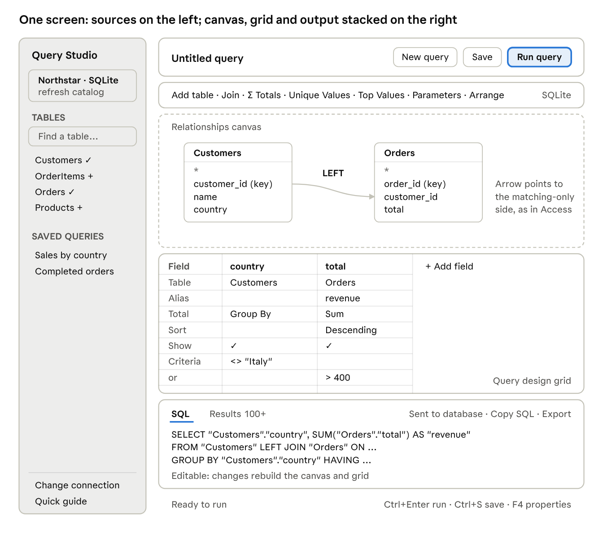

# Query Studio — UI Concept Specification

2026-11-28 · Exported from the [claude.ai document](https://claude.ai/artifact/22CtgyBqvHazgQFSmhkBxj). Companion documents: [technical design](technical-design.md) · [Access query designer reference](access-reference.md)

## Purpose and principles

This specification defines what users see and do in Query Studio. The screen layout comes from the prototype, `query-studio.html`, and the behaviour comes from the Microsoft Access query designer.

- **Layout from the prototype.** Regions, their order, the visual language (cards, grid, tabs) and the interactions the prototype introduced (drag, double-click, Shift-click) are kept.
- **Behaviour from Access.** Wherever the Access query designer defines how something works (join options, the Total row, naming, messages), Query Studio does the same. **SQL is standard SQL**: cells do not use Microsoft Access SQL syntax, and results are what the target database returns (decided 2026-11-28). The [Access reference](access-reference.md) records that behaviour with sources.
- **Conflicts are resolved explicitly.** Where the prototype and Access differ, the last section lists each difference and its resolution.
- **Not an implementation.** Nothing here prescribes a framework, component library or data structure. The UI design that follows chooses those.

The prototype's own code, data model and criteria parser are not part of this specification.

## Screen layout

The prototype's single-screen layout is kept: a sidebar of sources on the left and, on the right, the top bar, toolbar, relationships canvas, design grid and output panel stacked top to bottom.

The toolbar gains Access's Top Values and Parameters; the SQL dialect becomes a label set by the connection, no longer a choice.

## Connecting and the table list

The user picks a database first; its tables, views and saved queries then fill the sidebar, and a new query opens with the Add Tables pane showing, as Access does.

**Choosing a connection**

- On first visit a start card lists the connections the user may use, each with its name, database type and description. Users never type connection details.
- The last connection used opens automatically on the next visit.
- *Change connection* in the sidebar returns to the list. Unsaved changes trigger the unsaved-changes prompt first.
- The sidebar's connection card shows the connection name and database type, with a refresh button that re-reads the catalog.

**Sidebar table list**

- Heading *Tables* with a count, and a *Find a table…* search box that filters as the user types.
- One row per table or view: icon, name, a *view* tag for views, and a ✓ when the source is already on the canvas or + when it is not.
- Clicking a row adds the source to the canvas; dragging a row onto the canvas adds it where it is dropped.
- A second list, *Saved queries*, holds the user's saved queries. As in Access, a saved query can also be added to the canvas as a source.

**Add Tables pane**

- Opened from the toolbar's *Add table* and automatically for a new query.
- Tabs as in Access: *Tables*, *Queries*, *All*, with a search box.
- Several sources can be chosen at once; each is added to the canvas, and foreign keys draw their join lines automatically.
- Adding a source that is already on the canvas adds a second copy named `Customers_1`, as in Access.

## Relationships canvas

The canvas shows each source as a card with its field list, and each join as a line between two fields; it is the upper pane of the Access designer in the prototype's visual style.

**Table cards**

- A card has a coloured header with the source's name (or its alias, such as `Customers_1`) and a × that removes the source along with its grid columns and joins.
- The field list starts with `*` (all fields), then one row per field: a key icon on primary-key fields, the name, and a type badge (`123`, `abc`, `date`, `time`, `bool`, `bin`). Hovering shows the database's declared type and whether the field is required.
- Fields already in the grid show a small dot.
- Cards are moved by dragging the header, or with the arrow keys when the header has focus (10 px a step). *Arrange* lays cards out in rows of three.
- The canvas scrolls when cards extend beyond it. Card positions are saved with the query but never change its meaning.

**Adding fields to the grid**

- Double-click a field, press Enter on a focused field, or drag it onto the grid. Dragging `*` adds `Table.*`.
- Double-clicking a card's header selects all its fields; dragging that selection adds them all, as in Access.

**Creating joins**

- Drag a field onto a field of another source. Access's rule applies: the source dragged from becomes the left side.
- Alternatives kept from the prototype: Shift-click a field, then Shift-click a field in another card; or use *Join* in the toolbar to pick both fields in a dialog.
- Foreign keys create joins automatically when a source is added, as do fields that share a name and type where one side is a primary key (Access's AutoJoin rule). Automatic joins can be deleted.
- Sources with no line between them are cross-joined, without a warning, as in Access.

**Join lines**

- A line connects the two fields. For an outer join it carries an arrow pointing to the side that shows only matching rows, as in Access. The prototype's label (`INNER`, `LEFT`, `RIGHT`) stays on the line as well.
- Several lines between the same two sources form one compound join.
- Clicking a line selects it; Delete removes it. Double-clicking opens Join Properties.

**Join Properties dialog**

The dialog names the left and right source and field, and offers Access's three options, word for word:

1. Only include rows where the joined fields from both tables are equal.
2. Include ALL records from '*left source*' and only those records from '*right source*' where the joined fields are equal.
3. Include ALL records from '*right source*' and only those records from '*left source*' where the joined fields are equal.

The dialog also has a *Remove join* button, kept from the prototype. Joining fields of different types is refused with an explanation.

**Ambiguous outer joins.** When an outer join points toward an inner join, or two outer joins point toward each other, the lines involved are highlighted and Access's message is shown: "The SQL statement could not be executed because it contains ambiguous outer joins. To force one of the joins to be performed first, create a separate query that performs the first join and then include that query in your SQL statement."

## Query design grid

The grid sits below the canvas with one column per query field and one row per property, as in the prototype; its rows, options and criteria behave as the Access design grid does.

**Rows, top to bottom**

| Row | Shown | Content |
| --- | --- | --- |
| Field | Always | Field name, `Table.*`, or an expression; accepts Access's `Alias: expression` |
| Table | Always | The source's name or alias, read-only |
| Alias | Always | Output name; kept in step with an `Alias:` typed in the Field row |
| Total | When *Totals* is on | Group By, Sum, Avg, Min, Max, Count, StDev, Var, First, Last, Expression, Where |
| Sort | Always | Not sorted, Ascending, Descending |
| Show | Always | Checkbox; Spacebar toggles it |
| Criteria | Always | Standard SQL condition; the column may be left out |
| or | Always, plus any number more | Further alternative criteria rows |

**Columns**

- The column header shows the field name with ‹ and › to move the column and × to remove it, as in the prototype. Columns can also be dragged to a new position.
- *+ Add field* at the right end opens a dialog to pick a source and field. Typing a name or expression into the empty column's Field cell also adds a field, as in Access.
- Removing a source from the canvas removes its columns.

**Total row**

- Turning *Totals* on adds the row and sets every column to Group By, as in Access.
- Sum, Avg, StDev and Var are offered only for number fields. First and Last are not offered: Access returns an arbitrary row of the group for them, and its sort does not control which. Min and Max cover the reliable uses.
- Expression is for a field expression that already contains aggregates.
- Choosing Where clears Show and keeps it cleared. Ticking Show on a Where column is refused with Access's wording: "Query Studio can't display the field for which you entered Where in the Total row." To show the field, the user adds it a second time.
- Output names follow Access: `SumOfTotal`, `CountOfOrderID`; an unnamed expression is `Expr1`, `Expr2`.

**Criteria rows**

- Conditions in one row must all hold (AND); rows are alternatives (OR). The grid header keeps the prototype's hint: "Criteria on the same row are combined with AND".
- *Insert Rows* adds a criteria row above the selected one; *Delete Rows* removes it. There is no fixed limit on rows.
- Under a Group By or aggregate column, criteria filter the grouped results; under a Where column they filter rows before grouping. The user sees this from the column's Total setting, as in Access.
- A panel footnote keeps the prototype's examples, in standard SQL: `>= 100`, `'Completed'`, `LIKE 'S%'`, `IS NULL`. A cell may leave out its column (`>= 100` means "this column >= 100"; a bare value means equality), or be a complete condition.

**Editing a cell**

- Shift+F2 opens a Zoom box for long expressions, as in Access.
- Cell text is kept as typed. SQL edited in SQL view comes back into the grid in Calcite's standard SQL form, for example `IN ('A', 'B')` and `DATE '2026-11-01'`.
- An invalid cell gets a red outline and the message on hover, with the characters at fault underlined. Other cells stay editable.

**The `Table.*` column** has no Sort, Total or Criteria; those cells are disabled, with Access's guidance: add the field separately with Show cleared.

## Query properties and parameters

Query-wide settings live in the toolbar for the common ones and in a property sheet (F4) for all of them, as in Access.

| Setting | Where | Behaviour, as in Access |
| --- | --- | --- |
| Totals | Toolbar toggle (Σ) | Shows the Total row |
| Unique Values | Toolbar toggle (the prototype's *Distinct*) and property sheet | Removes duplicate rows over the shown fields |
| Unique Records | Property sheet, shown disabled | Not available yet; the sheet explains that Unique Values covers most needs |
| Top Values | Toolbar box (*Return*: 5, 25, 100, All, or typed) and property sheet | Returns the first *n* rows in sort order (`FETCH NEXT n ROWS ONLY`) |
| Output All Fields | Property sheet | Outputs every field of every source, so the grid needs only sort and criteria columns |
| Description | Property sheet | Free text shown with the saved query |

**Parameters**

- A named parameter is written `:name` in a criteria cell or expression, for example `>= :MinTotal` (decided 2026-11-28), and is prompted for at Run. The same parameter used twice asks once. The SQL Query Studio hands on keeps `:MinTotal`.
- *Parameters* in the toolbar opens a dialog listing each prompt with its data type, as Access's Query Parameters dialog does. Declaring a type lets Run reject an invalid value with a clear message.
- On Run, a dialog asks for each parameter in turn. The values are remembered for the session and offered again next time.

## Output panel

The panel below the grid has the prototype's two tabs, *SQL* and *Results*; unlike the prototype, the SQL tab is editable, because Access's SQL view is.

**SQL tab**

- Shows the query's SQL with line numbers and syntax colouring, updated as the design changes.
- The user can edit it. Leaving the editor or pressing Ctrl+Enter applies the edit: the canvas and grid are rebuilt from the SQL.
- SQL the designer cannot show (a UNION, a non-equality join, a subquery in FROM it cannot place) switches the query to SQL-only. The canvas and grid are replaced by a notice in Access's words, for example "Query Studio can't represent the join expression … in Design view". The query still runs and saves.
- A *Sent to database* toggle shows the SQL as generated for the connected database, read-only, for users who need to see exactly what runs.
- Actions: *Copy SQL* and *Export* (downloads a `.sql` file).

**Results tab**

- *Run query* (or Ctrl+Enter outside the SQL editor) runs the query on the database and switches to this tab, as Access switches to Datasheet view.
- A results table shows a row number column, the output columns with their names, numbers right-aligned, and `NULL` in grey italics for missing values. Results are read-only.
- The preview holds the first 100 rows; when there are more, the tab count reads `100+` and the footer says so.
- While a query runs, *Run query* becomes *Cancel*.
- An error replaces the table with the database's or Query Studio's message, and the grid cells at fault are marked.

**Status line**, as in the prototype: *Ready to run*, *Query changed · run to refresh*, *Running…*, or *N rows · N ms*. Any change to the design clears the previous results so stale rows are never shown.

## Saving and opening queries

Queries are saved on the server with every version kept, and reopen in the view they were saved in, as Access queries do.

- **Name.** The query name in the top bar is edited in place, as in the prototype; Enter confirms it. A new query is called *Untitled query*.
- **Save.** *Save* or Ctrl+S saves a new version. The first save of an untitled query asks for a name.
- **New query.** *New query* starts an empty design and opens the Add Tables pane.
- **Opening.** Clicking a saved query in the sidebar opens it with its layout restored. The open query is highlighted in the list.
- **Unsaved changes.** Opening another query, starting a new one, changing connection or leaving the page with unsaved changes asks first, with the prototype's three choices: *Cancel*, *Discard & continue*, *Save & continue*.
- **Someone else saved first.** If another user saved a newer version since this one was opened, Save offers to open the newer version or save this one as a copy. Nothing is overwritten silently.
- **Schema changes.** If a table or field the query uses no longer exists or has changed type, the query opens with the affected cards, lines and cells marked and the reason shown. Nothing is dropped silently.
- **Versions.** A query's history lists its versions with author and time; any version can be opened or restored.
- **Sharing.** The owner can share a query with named users or groups, as viewers or editors.

## Keyboard and accessibility

Everything the mouse can do has a keyboard route, using Access's keys where Access has them and the prototype's otherwise.

| Key | Action | From |
| --- | --- | --- |
| Ctrl+Enter | Run the query (in the SQL editor: apply the SQL) | Prototype |
| Ctrl+S | Save | Prototype |
| F4 | Open or close the property sheet | Access |
| Shift+F2 | Zoom box for the current cell | Access |
| F6 | Move between the canvas, the grid and the output panel | Access |
| Spacebar | Toggle Show in the grid | Access |
| Enter on a field | Add it to the grid | Prototype |
| Arrow keys on a card header | Move the card 10 px | Prototype |
| Delete | Remove the selected join line or grid column | Access |
| Esc | Cancel a Shift-click join in progress, or close a dialog | Prototype |

**Accessibility.** The target is WCAG 2.1 AA:

- Every control has a visible focus state and an accessible name.
- Joins can be created without dragging, through the Join dialog.
- Errors are announced to screen readers as well as outlined.
- Text meets AA contrast. Several of the prototype's light-grey labels do not, so they change colour.

**Desktop only.** Query Studio is a desktop application for desktop browsers. There is no phone or tablet layout; the prototype's narrow-screen rules are dropped.

## Where the prototype and Access differ

Where the two differ, Access's behaviour wins, unless the prototype adds something Access lacks without contradicting it; then both are kept.

| Topic | Prototype | Access | Resolution |
| --- | --- | --- | --- |
| Output name | Separate Alias row | `Alias: expression` in the Field row | Both, kept in step |
| Adding a source already on the canvas | Refused with a message | Adds a second copy, `Customers_1` | Access |
| Join line | Text label (`INNER`, `LEFT`) | Arrow toward the matching-only side | Both: arrow and label |
| Creating joins | Drag, Shift-click, Join dialog | Drag | All three kept |
| Join option wording | "Matching records only", "All records from the left table" | "Only include rows where the joined fields from both tables are equal", "Include ALL records from '…'" | Access |
| Removing duplicates | *Distinct* toggle | Unique Values property | Toggle kept, named *Unique Values* |
| Criteria rows | Criteria plus one *or* row | Any number of rows, Insert Rows and Delete Rows | Access |
| Total options | Group By, Count, Sum, Avg, Min, Max | Adds StDev, Var, Expression, Where | Access, without First and Last (arbitrary results) |
| Criteria on a Group By column | Applied in WHERE | Applied in HAVING | Access |
| Default output names | `sum_total`, duplicates get `_2` | `SumOfTotal`, `Expr1` | Access |
| Criteria syntax | SQL-like: `'Completed'`, `IS NULL` | Access: `"Completed"`, `#dates#`, `Is Null`, rewritten on leaving the cell | Standard SQL, as the prototype (decided 2026-11-28) |
| Wildcards | `*` and `?` translated to `%` and `_` | `* ? #` by default, `% _` in ANSI-92 mode | `%` and `_`, standard SQL |
| Text comparisons | Case-sensitive | Case-insensitive | As the target database defines them (decided 2026-11-28) |
| SQL view | Read-only preview | Editable; the grid is rebuilt from it | Access |
| SQL dialect | Dropdown in the toolbar | Not applicable | Removed; the connection sets it |
| Hidden columns on reopening | Stay where they were | Reported to move to the right (Access 2003 help; unverified now) | Prototype |
| Field type badges | Shown on each field | Not shown | Prototype |
| Top Values, Parameters, property sheet | Absent | Present | Access |

**Deliberate departures from Access**, all recorded as decisions in the technical design:

- Results are a read-only preview of the first 100 rows, there to check the design; there is no result export, because Query Studio's output is the SQL and other systems run it. Access datasheets can be editable and unbounded.
- Unique Records (`DISTINCTROW`) is not available at first.
- First and Last are left out of the Total row, because Access documents their result as arbitrary and no target database reproduces its row order.
- Only select queries are in scope. Make Table, Append, Update, Delete and Crosstab are not.
